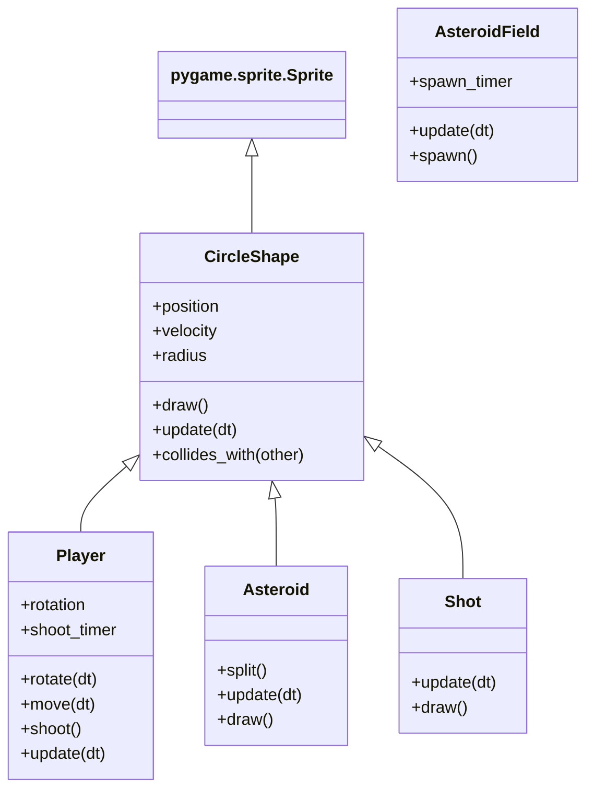

# Asteroids Game


## Controls

| Key | Action |
|---|---|
| W | Move forward |
| A | Turn left |
| D | Turn right |
| Space | Shoot |

## Scoring System

Points are given depending on the size of the asteroid destroyed.

| Asteroid Size | Points |
|---|---:|
| Large | 20 |
| Medium | 50 |
| Small | 100 |

Every 1000 points you get one life

## Features

- Player-controlled spaceship.
- Asteroids that move around the screen.
- Shooting system.
- Asteroids split into smaller asteroids.
- Collision detection.
- Score system.
- Lives system.
- Game logging.

## Technologies Used

- **Python:** Used to write the game.
- **Pygame:** Used for graphics, movement and controls.
- **GitHub:** Used to store and manage the project.

## How to Run the Game

1. Make sure Python is installed.
2. Install Pygame or uv 
```bash
   pip install uv
    OR
   pip install pygame
```
3. Download or clone the project.
4. cd in to Asteriods
5. Run `main.py`. like
    A. for pygame 
        python main.py
    B. for uv 
        uv run main.py

###
since the pytest are in a diffrent folder you have to first insall pytest on uv 
```bash
    uv add --dev pytest
```
then run with 
```bash
    uv run python -m pytest
```

## Project Files

| File | Purpose |
|---|---|
| `main.py` | Runs the game and controls the main game loop. |
| `Player.py` | Controls the spaceship and player movement. |
| `Asteroid.py` | Controls asteroid movement and splitting. |
| `AsteroidField.py` | Creates new asteroids. |
| `shot.py` | Controls the player's shots. |
| `CircleShape.py` | Contains shared movement and collision features. |
| `constants.py` | Stores important game settings and values. |
| `logger.py` | Records information about the game. |


## Input, Process, Output: Game Loop (`main()`)

| Step | Input | Process | Output |
|---|---|---|---|
| 1. Clear the screen | None | Clears the screen before drawing the next frame | A black screen |
| 2. Update objects | `dt` and the `updatable` group | Updates the player, shots and asteroids so they can move around the screen | Objects move and new asteroids can appear |
| 3. Draw objects | The `drawable` group and the screen | Draws all the game objects onto the screen | Player, shots and asteroids appear |
| 4. Check player collisions | Player and asteroid positions | Checks if the player has hit an asteroid and if they are protected by the invulnerability timer | Player loses a life and the asteroid splits |
| 5. Check lives | Player's lives | Checks if the player has run out of lives | Game closes if the player has no lives left |
| 6. Check shot collisions | Shot and asteroid positions | Checks if the player's shots hit any asteroids | Asteroids split and shots disappear |
| 7. Add points | Size of the asteroid hit | Gives different points depending on the asteroid's size | Player gets 20, 50 or 100 points |
| 8. Create text | Score and lives | Uses Pygame to create text showing the score and lives | Score and lives are ready to show |
| 9. Display text | Score and lives text | Places the score in the top left and lives in the top right | Player can see their score and lives |
| 10. Update the screen | Finished game frame | Uses `pygame.display.flip()` to show the latest frame | The updated game screen appears |
| 11. Log game state | Current game information | Uses `log_state()` to save information about the game | Game information is written to the log |
| 12. Check events | Pygame events | Checks if the player has closed the game window | Game closes when the player clicks the close button |
| 13. Control game speed | Game clock | Uses `clock.tick(60)` to keep the game running at 60 FPS and work out the time between frames | Gets `dt` for the next frame |


## Collison 

    def collides_with(self, other): 
        distance = self.position.distance_to(other.position)
        return distance <= (self.radius + other.radius)

this it the collsion decttion from CricleShape 
it checks if the radius of Calculate the distance between the center of the two circles: "distance"
Calculate the radius of each circle: r1 and r2.
If distance is less than or equal to r1 + r2, the circles are colliding. If not, they aren't!


## DOCUMENTATION
The actual coding part of this project didn't have many problems the biggest ones I faced was with github
sshing into the pared.compsci computer ment that the gmail was diffrent then our school one and becuse the school dosnt allow github emails to get though you cannot create a token or login on a diffrent device to over come this I used my home account to create and access token and pushed everything to my home account


